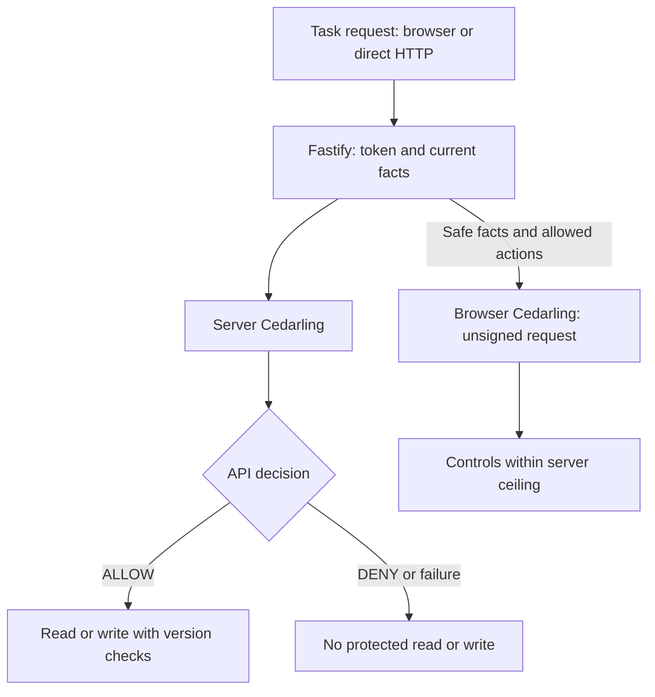

# Protect a Node.js REST API with Cedarling

Hello! In this tutorial, we'll add Cedarling authorization to a task manager app.

The app handles sign-in, but direct API requests let users read or change
tasks they neither own nor are assigned to, even across tenants. Creation,
assignment, completion, and deletion lack authorization checks, and a
task can be assigned to someone in another tenant.

We'll follow `Create` from policy to API handler: Alex, a contributor, must not
create tasks reserved for Mina, the owner. We'll block his request, check that
his assigned-task edits still work, and apply the remaining permissions.
The API will protect all six operations, and browser controls will reflect
those permissions.

If you are new to Cedarling, please read [What is Cedarling?](https://cedarling.dev/learn/what-is-cedarling) before continuing.

## The task manager we'll secure

The app uses React, a Fastify Node.js API, and SQLite. The repository's shared
local identity provider (IdP), built with `oidc-provider`, runs as a separate
Node.js service and handles sign-in and tokens.
After OIDC login, the API maps the verified issuer and subject (the IdP's user
identifier) to a local user. SQLite supplies that user's current tenant, role,
and assurance level.[^1]

For authorization, we'll use
[Token-Based Access Control (TBAC)](https://docs.jans.io/stable/cedarling/#proof-based-authorization-token-based-access-control-tbac):
Cedarling validates the access token and evaluates permission using these
current user facts.

`Assurance` describes confidence in how a user authenticated. Here, levels 1
and 2 are preset values for exercising the policy, not evidence of actual
multi-factor authentication. We'll use these accounts:

- **Alex** is a Tenant A contributor with assurance level 1. He works on assigned tasks.
- **Mina** has the Tenant A owner role and assurance level 2. She manages her team's work.
- **Sam** is a Tenant B external user with assurance level 1. His work must stay separate from Tenant A.

Cedarling decides whether an action is allowed: it is the policy decision
point (PDP). The API handlers enforce that decision: they are the policy
enforcement points (PEPs).

To follow along, complete each **Required step** section before continuing.

This application is for learning and is not intended for production use.

## Try the app before adding Cedarling

### Start the baseline app

You'll need Git, Node.js 24.21+ within 24.x, and pnpm 10.17.1. We assume basic
TypeScript and familiarity with HTTP requests, sessions, and access tokens.

Before starting, verify that the required tools are installed:

```bash
git --version
node --version
pnpm --version
```

#### Get the tutorial source

Use a separate checkout for P1 so its shared files and exercise data stay
separate from other tutorials:

```bash
git clone https://github.com/GluuFederation/cedarling-tutorials.git cedarling-p1
cd cedarling-p1
git switch --detach 21b0832be4b31271320df992d04e9d97667d0e38
cd p1-task-manager

# Prepare the tutorial steps.
git restore --source=850e38fd5dc4758848e3fcb05af40f3a9c68760c --worktree -- ../shared/tools/step
node ../shared/tools/step/run.mjs p1 init --source 850e38fd5dc4758848e3fcb05af40f3a9c68760c
```

#### Start the application locally

Run the remaining commands from `p1-task-manager/`. Paths under `shared/` are
relative to the repository root.

Start the app and IdP in two terminals.[^7]

**Terminal 1 — Start the Identity Provider**

Install and build the bundled identity provider, install the task manager dependencies, prepare the sample data, and start the IdP:

```bash
pnpm --dir ../shared/identity-provider install --frozen-lockfile
pnpm --dir ../shared/identity-provider build
pnpm install --frozen-lockfile
pnpm run setup
node --env-file=.local/idp/.env ../shared/identity-provider/dist/main.js
```

The IdP should start at `http://localhost:18001`.

You can verify that its OpenID Connect discovery endpoint is accessible by opening:

`http://localhost:18001/.well-known/openid-configuration`

Keep this terminal running while using the task manager.


**Terminal 2 — Start the Task Manager**

Open a second terminal in the same `p1-task-manager/` directory and run:

```bash
pnpm dev
```

The task manager should start at `http://localhost:17001`.

Keep both terminals running while testing the baseline application.

<details>
<summary>Optional: Run the starting app with Docker</summary>

With Docker and Compose installed, you can run the baseline instead of using
the native commands above:

```bash
docker compose up --build
```

This starts the app and IdP together. You can skip the two helper commands for
Docker-only exploration; run them before the coding steps. Native and Docker
use the same ports but separate data, so run only one stack at a time.

</details>

#### Sign in to the Task Manager

Open `http://localhost:17001`; the IdP runs at `http://localhost:18001`.

Sign in as Alex. The development IdP usually prefills `alex`; enter it if the field is empty.

Use any non-empty password, such as `cedarling-is-awesome`, then approve access.

After approval, the browser should return to the task manager with Alex signed in.

You are now ready to test task creation before adding Cedarling authorization.

### Create a task as Alex

Before adding Cedarling, let's verify that the baseline application allows Alex to create a task, even though his contributor role should not have that permission.

With Alex signed in at `http://localhost:17001`, use **either of the following methods** to create a task.

#### Option 1: Create a task using the UI

1. Click <kbd>**New task**</kbd>.
2. Enter a task title and description.
3. Click <kbd>**Create task**</kbd>.
4. Confirm that the task was created successfully and appears in the task list.

#### Option 2: Create a task using the browser console

You can also call the API directly using your browser's developer tools.

Open Developer Tools, select the **Console** tab, and run:

```js
const session = await fetch("/api/session").then((r) => r.json());
const response = await fetch("/api/tasks", {
  method: "POST",
  headers: {
    "content-type": "application/json",
    "x-csrf-token": session.csrfToken,
  },
  body: JSON.stringify({
    title: "Unauthorized creation",
    description: "Must not be saved",
  }),
});
console.log(response.status, await response.json());
```

**Note:** If your browser prevents you from pasting code into the developer console, follow the on-screen instructions to enable pasting. Some browsers may require typing `allow pasting` and pressing Enter. Only paste code you trust.

The application returns **201** and saves the task. Reload to see it.
Authentication and CSRF checks passed for Alex's session, but nothing checked
whether he may create a task.

Keep the response and saved task for comparison. Stop the app in the second
terminal before editing; keep the IdP running.

<details>
<summary>If using Docker: Switch to native development</summary>

Stop the stack with <kbd>Ctrl+C</kbd> , then run `docker compose down` to keep its data
volume. Run the helper setup commands if you skipped them, then install
dependencies and start the native IdP using the first-terminal commands above.
Sign in again when the native app starts. Tasks created in Docker remain in
that stack's database.

</details>

### Where should we check permission?

Alex's task was saved. Open the baseline's
[`src/server/app.ts`](https://github.com/GluuFederation/cedarling-tutorials/blob/21b0832be4b31271320df992d04e9d97667d0e38/p1-task-manager/src/server/app.ts)
and find `POST /api/tasks`. It authenticates the session, checks request
integrity, validates the input, then calls `database.createTask()`. None of
those checks asks whether Alex is allowed to create a task.

We'll check `Create` here, before `database.createTask()`. The existing
`task.create` label names the operation but does not enforce permission.
Authentication, CSRF, input validation, and stale-write checks stay in place.

## Add Cedarling to the app

Fastify will ask its Cedarling instance before returning task data or changing
it. The browser receives user and task facts, plus the server's allowed
actions, for its own control checks:



### Decide who can do what

Every operation requires the user's current tenant to match the resource tenant.
For existing tasks, "related" means the user owns the task or is its assignee.

| Capability      | Action                                                                                                                                                                            | Resource | Additional conditions                                                     |
| --------------- | --------------------------------------------------------------------------------------------------------------------------------------------------------------------------------- | -------- | ------------------------------------------------------------------------- |
| `task.view`     | [`View`](https://github.com/GluuFederation/cedarling-tutorials/blob/main/p1-task-manager/policy-store/policies/server-access.cedar#L8 "server-view-related-task")                 | `Task`   | Related user                                                              |
| `task.create`   | [`Create`](https://github.com/GluuFederation/cedarling-tutorials/blob/main/p1-task-manager/policy-store/policies/server-access.cedar#L33 "server-owner-create-task")              | `Tenant` | Owner role, assurance at least 2                                          |
| `task.edit`     | [`Edit`](https://github.com/GluuFederation/cedarling-tutorials/blob/main/p1-task-manager/policy-store/policies/server-access.cedar#L58 "server-edit-related-task")                | `Task`   | Related user                                                              |
| `task.assign`   | [`Assign`](https://github.com/GluuFederation/cedarling-tutorials/blob/main/p1-task-manager/policy-store/policies/server-access.cedar#L83 "server-owner-assign-task")              | `Task`   | Task owner, owner role, assurance at least 2, assignee in the same tenant |
| `task.complete` | [`Complete`](https://github.com/GluuFederation/cedarling-tutorials/blob/main/p1-task-manager/policy-store/policies/server-access.cedar#L111 "server-owner-complete-related-task") | `Task`   | Related user, owner role, assurance at least 2                            |
| `task.delete`   | [`Delete`](https://github.com/GluuFederation/cedarling-tutorials/blob/main/p1-task-manager/policy-store/policies/server-access.cedar#L138 "server-owner-delete-task")             | `Task`   | Task owner, owner role, assurance at least 2                              |

An action's full identifier looks like `Task::Action::"Create"`. Creation
targets the existing `Task::Tenant` because the new task does not yet exist.[^2]
These rules combine roles, attributes, and relationships.[^3] 

The **owner role** belongs to a tenant; a **task owner** is the user in that task's `ownerId`. These are different concepts.

For example:

- **Alex:** Can view and edit tasks he owns or is assigned to, but cannot create, assign, complete, or delete tasks under these rules.
- **Mina:** Can create tasks in Tenant A and perform other operations when the required task relationship and conditions are satisfied.
- **Sam:** Can access related tasks in Tenant B but cannot access Tenant A tasks, even if he knows their IDs.

These permissions will be defined in Cedar policies and enforced by the API before protected task data is returned or modified.

### Create the policy-store files

We'll create a `policy-store/` directory inside `p1-task-manager/` using Cedarling's [directory-based format](https://docs.jans.io/stable/cedarling/reference/cedarling-policy-store/#2-new-directory-based-format):

The policy store contains the Cedar schema, authorization policies, trusted issuer configuration, and metadata used by Cedarling.

```text
policy-store/
  metadata.json
  schema.cedarschema
  policies/
    server-access.cedar
    browser-shadow-access.cedar
  trusted-issuers/
    tutorial-idp.json
```

<details>
<summary>Required step: Create the five policy-store files</summary>

From `p1-task-manager/`, run:

```bash
node ../shared/tools/step/run.mjs p1 policy-store
```

The helper displays the files it will create or update and may ask for confirmation. Review the proposed changes and enter <kbd>y</kbd> to apply them.

The command creates the following files:

- [`metadata.json`](https://github.com/GluuFederation/cedarling-tutorials/blob/main/p1-task-manager/policy-store/metadata.json) identifies the store, Cedar version, and policy version `1.0.0`.
- [`schema.cedarschema`](https://github.com/GluuFederation/cedarling-tutorials/blob/main/p1-task-manager/policy-store/schema.cedarschema) defines actions, entities, and request context.
- [`trusted-issuers/tutorial-idp.json`](https://github.com/GluuFederation/cedarling-tutorials/blob/main/p1-task-manager/policy-store/trusted-issuers/tutorial-idp.json) defines the trusted token mapping.
- [`policies/server-access.cedar`](https://github.com/GluuFederation/cedarling-tutorials/blob/main/p1-task-manager/policy-store/policies/server-access.cedar) holds the six server permission rules.
- [`policies/browser-shadow-access.cedar`](https://github.com/GluuFederation/cedarling-tutorials/blob/main/p1-task-manager/policy-store/policies/browser-shadow-access.cedar) holds the matching browser guidance rules.

</details>

We'll supply current user and task facts with each request.[^4] 

Cedar's schema defines the types those requests may contain:

- `principal` - who is performing the action.
- `action` - the operation being requested.
- `resource` - the target of the operation.
- `context` - additional facts needed to evaluate the policies.

See the [Cedar schema syntax reference](https://docs.cedarpolicy.com/schema/human-readable-schema.html)
when reading `schema.cedarschema`.

For `Create`, the resource is the user's tenant. The trusted-issuer file points
Cedarling to the local IdP so it can validate the access token intended for
`http://localhost:17001/api`. The ID token is used during OIDC login.

<details>
<summary>How the schema and trusted-issuer mapping fit together</summary>

The server supplies tokens instead of a principal entity. `Task::Any` satisfies
Cedar's principal-type declaration; browser requests use `Task::User`.
`RequestContext` describes the boundary, current user, optional new assignee's
tenant, and token context. `Create` accepts a `Tenant` resource:

```cedar
// policy-store/schema.cedarschema
namespace Task {
  // ... entity types, RequestContext, and other actions omitted.
  action "Create" appliesTo {
    principal: [Any, User],
    resource: [Tenant],
    context: RequestContext
  };
}
```

The schema's `P1TaskManager` namespace describes the issuer and access-token
entity. `trusted-issuers/tutorial-idp.json` tells Cedarling where to discover
the issuer and how to map its tokens:

```json
{
  "name": "P1TaskManager",
  "description": "Shared Cedarling tutorial identity provider",
  "openid_configuration_endpoint": "http://localhost:18001/.well-known/openid-configuration",
  "token_metadata": {
    "access_token": {
      "trusted": true,
      "entity_type_name": "P1TaskManager::Access_token",
      "token_id": "jti",
      "required_claims": ["iss", "sub", "aud", "jti", "exp", "scope"]
    }
  }
}
```

Cedarling exposes the validated access-token claims through `context.tokens`.

</details>

### Set the conditions for `Create`

In `policies/server-access.cedar`, `Create` checks the token's subject,
audience, and scope, then the user's tenant, role, and assurance:

```cedar
// policy-store/policies/server-access.cedar
@id("server-owner-create-task")
permit(
  principal,
  action == Task::Action::"Create",
  resource is Task::Tenant
) when {
  context.boundary == "server" &&
  context has user &&
  context has tokens &&
  context.tokens has p1taskmanager_access_token &&
  context.tokens.p1taskmanager_access_token.hasTag("sub") &&
  context.tokens.p1taskmanager_access_token.getTag("sub").contains(context.user.subject) &&
  context.tokens.p1taskmanager_access_token.hasTag("aud") &&
  context.tokens.p1taskmanager_access_token.getTag("aud").contains("http://localhost:17001/api") &&
  context.tokens.p1taskmanager_access_token has scope &&
  (context.tokens.p1taskmanager_access_token.scope == "task.create" ||
    context.tokens.p1taskmanager_access_token.scope like "task.create *" ||
    context.tokens.p1taskmanager_access_token.scope like "* task.create" ||
    context.tokens.p1taskmanager_access_token.scope like "* task.create *") &&
  context.user.tenant_id == resource.tenant_id &&
  context.user.role == "owner" &&
  context.user.assurance_level >= 2
};
```

Alex passes the tenant check but fails the owner-role and assurance checks.
Mina meets both; her token must also pass the subject, audience, and scope
checks. A scope requested at login alone does not grant permission.

`p1taskmanager_access_token` is Cedarling's generated key in `context.tokens`.
Policies read the `sub` and `aud` claims as tags. The `scope` claim contains
space-separated permissions; this rule matches `task.create` as a whole entry
anywhere in that list.

The other five server policies use the same token and tenant checks, with
the additional conditions in the capability table. Each `@id` identifies a
rule in decision logs.

<details>
<summary>What changes in the browser policies?</summary>

The browser rules use `context.boundary == "browser"` and a `Task::User`
principal built from server-supplied fields. They check tenant, role,
assurance, and task relationships without reading JWTs. For example,
`browser-owner-create-task` requires the owner role and assurance of at least 2
in the selected tenant.

</details>

No matching `permit` means `DENY`. See the
[Cedar policy syntax](https://docs.cedarpolicy.com/policies/syntax-policy.html).

### Map each operation to a permission check

Each route selects its action and builds a request from the session token and
current user and resource facts loaded from the database. For `Assign`, also
load the proposed assignee's tenant. Wait for `ALLOW` before returning data or
making a change. Keep the server-selected owner and tenant on creation, and
expected-version checks on existing-task writes.

Denied task operations return **404**, the same as an absent task; denied
creation returns **403**. Unavailable authorization returns **503** and stops
the operation.

### Install Cedarling and build the policy archive

From `p1-task-manager/`, install the integration's dependencies:

```bash
pnpm add --save-exact @janssenproject/cedarling_wasm@0.0.468 fflate@0.8.3
pnpm add --save-exact @fastify/cookie@11.1.3 @fastify/helmet@13.2.0 @fastify/static@10.1.6 @fastify/swagger@9.9.2
pnpm add --save-exact react@19.3.1 react-dom@19.3.1
pnpm add --save-dev --save-exact @cedar-policy/cedar-wasm@4.12.0 @types/node@24.19.0 vitest@4.1.12
```
The two WASM packages serve different purposes:

- `cedar-wasm` validates Cedar policy and schema syntax during archive generation.
- `cedarling_wasm` initializes Cedarling and evaluates application authorization requests. 
We'll use a shared builder to package the policy store.

<details>
<summary>Required step: Create the shared archive builder</summary>

Add the builder and its type declarations:

```bash
node ../shared/tools/step/run.mjs p1 archive-builder
```

[`shared/policy-store.mjs`](https://github.com/GluuFederation/cedarling-tutorials/blob/main/shared/policy-store.mjs)
validates and packages the files; `shared/policy-store.d.mts` supplies its types.

</details>

**Build the policy archive**

From `p1-task-manager/`, run:

```bash
node ../shared/policy-store.mjs
```

The builder validates the policy-store files and creates `.local/policy-store.cjar`, a ZIP-format archive that Cedarling loads at runtime.
A successful build displays a message similar to:

```text
Built policy store 1.0.0 | sha256 15dd5f...
```

Keep the source `policy-store/` directory in Git. After modifying the schema, policies, metadata, or trusted issuer configuration, 
rebuild the archive and restart the application so Cedarling loads the updated version.

### Create one Cedarling instance for the server

<details>
<summary>Required step: Update server authorization and its shared types</summary>

Run:

```bash
node ../shared/tools/step/run.mjs p1 server
```

This connects [`authorization-trace.ts`](https://github.com/GluuFederation/cedarling-tutorials/blob/main/p1-task-manager/src/server/authorization-trace.ts)
to the [API routes](https://github.com/GluuFederation/cedarling-tutorials/blob/main/p1-task-manager/src/server/app.ts)
and startup. It also adds [shared authorization types](https://github.com/GluuFederation/cedarling-tutorials/blob/main/p1-task-manager/src/shared/authorization.ts)
and updates the server configuration and build.

</details>

In `src/server/authorization-trace.ts`, `createServerAuthorization()` receives
the project directories and loads the archive once at startup:

```ts
// src/server/authorization-trace.ts
import { readFile } from "node:fs/promises";
import path from "node:path";
import { initFromArchiveBytes } from "@janssenproject/cedarling_wasm";

const archiveName = "policy-store.cjar";
// ... other imports, types, and helpers omitted.

export async function createServerAuthorization(
  options: Readonly<{
    projectRoot: string;
    dataDirectory: string;
  }>,
): Promise<ServerAuthorization> {
  const archive = new Uint8Array(
    await readFile(path.join(options.projectRoot, ".local", archiveName)),
  );
  // ... calculate the digest, read metadata, and register the archive.
  const cedarling = await initFromArchiveBytes(
    {
      CEDARLING_APPLICATION_NAME: "P1 Task Manager server",
      CEDARLING_LOG_TYPE: "memory",
      CEDARLING_LOG_TTL: 300,
      CEDARLING_JWT_SIG_VALIDATION: "enabled",
      CEDARLING_JWT_SIGNATURE_ALGORITHMS_SUPPORTED: ["RS256"],
      CEDARLING_STRICT_SCHEMA_VALIDATION: "enabled",
      CEDARLING_TRUSTED_ISSUER_LOADER_TYPE: "SYNC",
    },
    archive,
  );
  if (cedarling.loadedTrustedIssuersCount() < 1) {
    await cedarling.shutDown();
    throw new Error("P1 requires at least one trusted issuer");
  }
  // ... build the policy descriptor and return authorization methods.
}
```

Keep the IdP running: Cedarling fetches its configuration and signing keys
during initialization. `SYNC` waits for configured issuers to load. The count
check also rejects an archive with no issuer definitions, which Cedarling can
otherwise initialize. Strict schema validation rejects an invalid model.

[`src/server/main.ts`](https://github.com/GluuFederation/cedarling-tutorials/blob/main/p1-task-manager/src/server/main.ts)
passes this instance's authorization functions to `buildApp()` and closes it
when the server stops.

### Check permission before saving a task

Inside `createServerAuthorization()`, `authorize()` receives the trusted
session and the action's target. It builds a token-based request and rejects
evaluation errors:

```ts
// src/server/authorization-trace.ts, inside createServerAuthorization()
async function authorize(
  requestId: string,
  session: Session,
  target: AuthorizationTarget,
): Promise<boolean> {
  try {
    const result = await cedarling.authorizeMultiIssuer(
      JSON.stringify({
        tokens: tokenSet(session),
        ...requestItem(session, target),
      }),
    );
    logDecision(requestId, session, target.capability, result.request_id);
    if (result.response.diagnostics.errors.length > 0)
      throw new Error("Cedarling returned policy evaluation errors");
    return result.decision;
  } catch (error) {
    logFailure(requestId, session, [target]);
    throw error;
  }
}
```

<details>
<summary>What does the Create request contain?</summary>

For creation in the user's tenant, the helpers produce this request:

```ts
// src/server/authorization-trace.ts: request passed by authorize() for Create
({
  tokens: [
    {
      mapping: "P1TaskManager::Access_token",
      payload: session.tokens.accessToken,
    },
  ],
  action: 'Task::Action::"Create"',
  resource: {
    cedar_entity_mapping: {
      entity_type: "Task::Tenant",
      id: session.user.tenantId,
    },
    tenant_id: session.user.tenantId,
  },
  context: {
    boundary: "server",
    user: {
      id: session.user.id,
      subject: session.user.subject,
      tenant_id: session.user.tenantId,
      role: session.user.role,
      assurance_level: session.user.assuranceLevel,
    },
  },
});
```

</details>

`authorizeMultiIssuer()` expects a JSON string; `JSON.stringify()` converts the
request object to that format.[^5] `logDecision()` links the application
request to Cedarling's logs; `logFailure()` records errors without tokens or
raw error messages.

The updated `POST /api/tasks` handler calls authorization after authentication,
CSRF, and input checks, but before the database write:

```ts
// src/server/app.ts
// Inside buildApp():
app.post(
  "/api/tasks",
  { schema: apiSchema(capabilities.create) },
  async (request, reply) => {
    // ... authenticate session, check CSRF, and validate parsed input.
    if (
      !(await authorize(
        session,
        { capability: capabilities.create, tenantId: session.user.tenantId },
        reply,
        403,
      ))
    )
      return;
    const task = database.createTask(
      session.user,
      parsed.data.title,
      parsed.data.description,
    );
    return reply.code(201).send({ task });
  },
);
```

If denied, the route's `authorize()` helper sends 403; if evaluation fails, it
sends 503. In both cases, the handler returns before the write. An allowed
request reaches `database.createTask()` and returns 201.

For task lists and control previews, `authorizeMultiIssuerBatch()` checks
several action/resource pairs with the same tokens. It checks each item's
success and diagnostics before using its decision. Only allowed tasks appear
in the list.

### Test task creation as Alex and Mina

Now let's verify that the API enforces the Cedarling `Create` policy.

Keep the native IdP running. In the application terminal, run:

```bash
pnpm exec vite build
pnpm exec tsc -p tsconfig.server.json
pnpm start
```

The application should start successfully and display the policy version and SHA-256 in the terminal.

Open `http://localhost:17001/health` and confirm that it returns:

```json
{ "status": "ok" }
```

#### Test as Alex - Create denied

Sign in as Alex, reload the task manager, and repeat the API request from **Create a task as Alex**.

**Expected result:** HTTP `403 Forbidden`. No new task should be created.


#### Test as Mina - Create allowed

Select **Change account** and sign in as Mina.

Run the same request again. The snippet retrieves the CSRF token for the currently signed-in user.

**Expected result:** HTTP `201 Created`.

Reload the task list and confirm that Mina's new task appears.


Use **Change account** between users or separate browser profiles; ordinary
tabs share a session.

Switch back to Alex, open **Prepare launch brief**, change its description,
and save. His assigned-task edit should still succeed.

### Show the actions each user can take

The API now denies Alex's creation request, but the browser still offers the
action. We'll connect its controls to the server's permissions next.

<details>
<summary>Required step: Update browser authorization and controls</summary>

Run:

```bash
node ../shared/tools/step/run.mjs p1 browser
```

This adds [browser authorization](https://github.com/GluuFederation/cedarling-tutorials/blob/main/p1-task-manager/src/web/authorization-trace.ts)
and connects it to the API client, shared types, and [React controls](https://github.com/GluuFederation/cedarling-tutorials/blob/main/p1-task-manager/src/web/App.tsx).

</details>

The server returns its currently allowed actions, called the **decision
ceiling**. Browser Cedarling can narrow that list. Alex can edit his assigned
brief, but browser evaluation cannot give him `Create` permission.

The API sends this list with user facts, policy information, versions, and an
expiry time in an **authorization envelope**. Tokens and session IDs stay on the
server. `loadPolicy()` fetches the browser's policy archive from the app and
checks its hash before initializing Cedarling. The unsigned browser instance
uses server-supplied facts; server token validation stays enabled.

<details>
<summary>Browser policy loading</summary>

In `src/web/authorization-trace.ts`, `loadPolicy()` fetches the archive
from `/policy-store/<sha256>.cjar` on the app's origin, verifies its hash, and
passes the bytes to Cedarling:

```ts
// src/web/authorization-trace.ts
async function loadPolicy(
  policy: AuthorizationEnvelope["policy"],
): Promise<ActivePolicy> {
  // ... reuse an existing instance and validate the archive URL.
  const promise = (async () => {
    // ... fetch bytes and verify their SHA-256 against policy.sha256.
    const cedarling = await initFromArchiveBytes(
      {
        CEDARLING_APPLICATION_NAME: "P1 Task Manager browser",
        CEDARLING_LOG_TYPE: "memory",
        CEDARLING_LOG_TTL: 300,
        CEDARLING_JWT_SIG_VALIDATION: "disabled",
        CEDARLING_JWT_STATUS_VALIDATION: "disabled",
        CEDARLING_STRICT_SCHEMA_VALIDATION: "enabled",
      },
      bytes,
    );
    // ... store this instance and close the previous one.
    return active;
  })();
  // ... track the pending load, await promise, and clear pending state.
}
```

The browser instance disables JWT signature and status validation 
because it uses unsigned authorization requests and does not receive JWTs.

</details>

`authorizePresentation()` builds a `Task::User` principal from the server's
user facts and batches the control checks. Each item contains its action,
resource, and browser context; assignment also includes the proposed
assignee's tenant:

```ts
// src/web/authorization-trace.ts, inside authorizePresentation()'s try block
const { cedarling } = await loadPolicy(envelope.policy);
// ... recheck envelope freshness after the asynchronous load.
const batch = await cedarling.authorizeUnsignedBatch(
  JSON.stringify({
    principal: {
      cedar_entity_mapping: { entity_type: "Task::User", id: user.id },
      id: user.id,
      tenant_id: user.tenantId,
      role: user.role,
      assurance_level: user.assuranceLevel,
    },
    items,
  }),
);
// ... check batch results and narrow the server ceiling.
```

After checking item success and diagnostics, the browser shows controls
allowed by both decisions. Expired permissions, a changed user, or mismatched
versions clear the controls and trigger a refresh. If browser evaluation
fails while the envelope is current, the UI uses the server ceiling and logs
a warning. Every attempted operation still gets a fresh server check.

Stop the running API process (`pnpm start`) using `Ctrl+C`, but **keep the native IdP running** in its separate terminal.

From `p1-task-manager/`, run:

```bash
pnpm exec tsc --noEmit -p tsconfig.web.json
pnpm exec vite build
pnpm start
```

After restarting the API, reload the task manager page. Alex should no longer
see the **New task** button but should still be able to edit his assigned
brief. Mina can create, and browser logs show unsigned Cedarling decisions.

### Update startup and Docker builds

We'll now update the startup process so the policy archive is built automatically.

<details>
<summary>Required step: Update setup, development startup, and Docker packaging</summary>

From `p1-task-manager/`, run:

```bash
node ../shared/tools/step/run.mjs p1 startup
```

This updates setup, development startup, [Docker packaging](https://github.com/GluuFederation/cedarling-tutorials/blob/main/p1-task-manager/Dockerfile),
and the `build` and `dev` package scripts. The [development supervisor](https://github.com/GluuFederation/cedarling-tutorials/blob/main/shared/dev-supervisor.mjs)
starts the IdP, browser watcher, and API together.

</details>

Run `pnpm build` to check packaging. Then stop both native terminals and run
`pnpm dev`. From this point on, that single command starts the whole stack.

<details>
<summary>Optional: Run the integrated app with Docker</summary>

Stop the native stack first, then run:

```bash
docker compose up --build
```

Docker builds the policy archive from the same source files. It uses its own
data volumes; sign in again after switching.

</details>

<details>
<summary>Troubleshooting startup and request errors</summary>

- Occupied ports: stop the other P1 checkout or startup method; native and Docker use the same ports.
- Issuer loading: start the IdP first at `http://localhost:18001`; keep the API audience at `http://localhost:17001/api`.
- Policy validation: check the named source file, complete contents, and unique policy IDs before rebuilding.
- Stale write (409): fetch the current task version instead of resending an old version.
- Browser WASM or discovery errors: use the copied browser authorization and server files; only the unsigned browser instance disables JWT checks.

</details>

## Check allowed and denied operations

With the integrated app running, we'll check the other actions as well as
Alex's creation request.

### Retry Alex's request, then edit his assigned task

<details>
<summary>If needed: Reset the native sample data</summary>

Stop the exercise services first. For native execution, run `pnpm reset`, then
`pnpm dev` from this checkout's `p1-task-manager/`. Reset removes `.data`,
including SQLite tasks, sessions, and stored policy artifacts; it preserves
`.env` and `.local/idp/.env`. Startup recreates fixtures. Sign in again. Do not
reset data you want to keep.

</details>

<details>
<summary>If using Docker: Reset the sample data</summary>

For this checkout's Docker stack, run `docker compose down --volumes`, then
`docker compose up --build`. This deletes its data and generated app/IdP
configuration volumes. Do not reset data you want to keep. Sign in again afterward.

</details>

Use fresh exercise data for the integrated run. Sign in as Alex, reload the
page, and repeat the original console request. It returns **403** with
`{"error":"forbidden"}`; reloading shows no new task. A hidden **New task** button alone
would not prove this: the direct request bypasses the interface.

Open **Prepare launch brief**, edit its title, and select **Save changes**. It
succeeds because Alex is assigned this Tenant A task.

Use the original sample data to check these outcomes:

| Operation  | Alex, Tenant A                                   | Mina, Tenant A                                  | Sam, Tenant B                      |
| ---------- | ------------------------------------------------ | ----------------------------------------------- | ---------------------------------- |
| `View`     | `ALLOW` assigned brief; `DENY` unassigned review | `ALLOW` owned A tasks                           | `ALLOW` own B task; `DENY` A tasks |
| `Create`   | `DENY`                                           | `ALLOW` in A                                    | `DENY`                             |
| `Edit`     | `ALLOW` assigned brief                           | `ALLOW` owned A tasks                           | `ALLOW` own B task; `DENY` A tasks |
| `Assign`   | `DENY`                                           | `ALLOW` owned task to A user; `DENY` B assignee | `DENY`                             |
| `Complete` | `DENY`                                           | `ALLOW` related A task                          | `DENY`                             |
| `Delete`   | `DENY`                                           | `ALLOW` owned A task                            | `DENY`                             |

Use a separate session for each person, or sign out between accounts. The
requests below let us exercise denied operations even when their controls are hidden.

<details>
<summary>Required step: Exercise the permission matrix through the API</summary>

Run these requests in the browser console on `http://localhost:17001` while
signed in as the account being checked. The sample records are:

| Task ID         | Tenant | Owner       | Assignee    |
| --------------- | ------ | ----------- | ----------- |
| `task-a-brief`  | A      | `user-mina` | `user-alex` |
| `task-a-review` | A      | `user-mina` | `user-mina` |
| `task-b-notes`  | B      | `user-sam`  | `user-sam`  |

Paste this console helper once per session to send requests with its CSRF token:

```js
// Browser console on the task manager page
async function taskRequest(method, path, body) {
  const sessionResponse = await fetch("/api/session");
  if (!sessionResponse.ok) throw new Error("Sign in before testing");
  const { csrfToken } = await sessionResponse.json();
  const response = await fetch(path, {
    method,
    headers:
      body === undefined
        ? {}
        : {
            "content-type": "application/json",
            "x-csrf-token": csrfToken,
          },
    body: body === undefined ? undefined : JSON.stringify(body),
  });
  const result = await response.json();
  console.log(response.status, result);
  return result;
}
```

As each account, check `View`:

```js
await taskRequest("GET", "/api/tasks/task-a-brief");
await taskRequest("GET", "/api/tasks/task-a-review");
await taskRequest("GET", "/api/tasks/task-b-notes");
```

Alex sees only the brief, Mina sees both A tasks, and Sam sees only his B task.
Allowed reads return **200**; the other reads return **404**. Repeat the original
`Create` request for each account: Mina gets **201**, Alex and Sam get **403**.

For an allowed read, take the current `task.version` before every write. For
example, Alex can edit his brief with:

```js
var currentTask = (await taskRequest("GET", "/api/tasks/task-a-brief")).task;
await taskRequest("PATCH", "/api/tasks/task-a-brief", {
  title: "Updated launch brief",
  description: currentTask.description,
  version: currentTask.version,
});
```

Repeat for Mina's A tasks and Sam's B task: expect **200**. As Sam, try editing
`/api/tasks/task-a-brief` with a valid body and the version read by Alex or Mina.
Expect **404**, then confirm as Mina that its title and version did not change.

For the remaining requests, set `var taskId = "task-a-brief"` (or
`"task-b-notes"` for Sam's own task) in the console. Before each write to a
readable task, run:

```js
var version = (await taskRequest("GET", "/api/tasks/" + taskId)).task.version;
```

For a task that this account cannot read, set `var version` to the version
obtained in an authorized session. Run the request shapes below one at a time,
following the account order afterward:

```js
await taskRequest("POST", `/api/tasks/${taskId}/assign`, {
  assigneeId: "user-alex",
  version,
});
await taskRequest("POST", `/api/tasks/${taskId}/complete`, { version });
await taskRequest("DELETE", `/api/tasks/${taskId}`, { version });
```

1. As Alex, use `taskId = "task-a-brief"` and its current version. `Assign`,
   `Complete`, and `Delete` each return **404**. Read the task again to confirm
   that it is unchanged.
2. As Sam, repeat those three requests for `task-b-notes`, which he can read.
   Each returns **404**. Repeat them against `task-a-brief` using its version
   from an authorized session; they also return **404**. Verify the A task as Mina.
3. As Mina, assign `task-a-brief` to `user-alex`: expect **200**. Read its new
   version, then try `assigneeId: "user-sam"`: expect **404** and no change.
4. Finish as Mina by completing `task-a-brief` (**200**), reading its new
   version, and deleting it (**200**). Do these last so earlier checks still
   have a task to inspect. A subsequent read returns **404** because it is now gone.

Confirm a denied task still exists in its owner's session: **404** also means
absent. **409** means a stale task version; **400** means invalid input. Use
valid input and the current version to isolate the permission check.

</details>

### Read the decision logs

In the API terminal or Compose output, match the application record's
`cedarlingRequestId` to Cedarling's `request_id`. One HTTP request can produce
several decisions. `JSON.stringify(log, null, 2)` indents their nested fields.

Alex's denied creation request produces these Cedarling log fields:

```json
{
  "log_kind": "Decision",
  "action": "Task::Action::\"Create\"",
  "resource": "Task::Tenant::\"tenant-a\"",
  "decision": "DENY",
  "principal": [],
  "diagnostics": { "reason": [], "errors": [] }
}
```

This excerpt shows selected fields. `principal: []` is expected for a
token-based request. The empty `reason` means no policy determined the decision;
it does not identify failed conditions.[^6]

For Alex's allowed edit, find `server-edit-related-task` in
`diagnostics.reason`. The store version identifies the rules; the startup
SHA-256 identifies their archive bytes.

In the browser console, look for
`P1 browser | ALLOW | Task::Action::"Edit"`. A fallback warning means browser
evaluation was unavailable and the UI used the current server ceiling.

Review captures before sharing: keep tokens, cookies, CSRF values, and session
objects private. Decision logs also contain user and resource identifiers.

### Test stale permissions and authorization failures

We'll now check expired controls, delayed responses, and authorization
failures with the integration's tests.

<details>
<summary>Required step: Add the matching tests and check configuration</summary>

Add the checks and install their browser test runner:

```bash
node ../shared/tools/step/run.mjs p1 checks
pnpm add --save-dev --save-exact @playwright/test@1.63.0
```

This adds the policy and [browser permission tests](https://github.com/GluuFederation/cedarling-tutorials/blob/main/p1-task-manager/test/browser-authorization.test.ts),
updates the baseline tests and configuration, and connects browser verification
to `pnpm check`. The [end-to-end test](https://github.com/GluuFederation/cedarling-tutorials/blob/main/p1-task-manager/e2e/task-authorization.e2e.ts)
uses the real IdP and disposable data.

</details>

In [`test/policy-store.test.ts`](https://github.com/GluuFederation/cedarling-tutorials/blob/main/p1-task-manager/test/policy-store.test.ts),
find `create a task as an assured owner` and compare its Mina request with
Alex's role and assurance. Other cases vary scopes, tenants, and task
relationships. API tests verify that unavailable authorization returns 503
without changing protected data.

Stop P1 and its IdP to free ports 17001 and 18001. From the same checkout's
`p1-task-manager/`, run:

```bash
pnpm exec playwright install chromium
pnpm format
pnpm check
```

On Linux, missing browser libraries may require
`pnpm exec playwright install --with-deps chromium`. Expect the check to pass
formatting, lint, types, unit tests, build, and browser verification.
Its browser test repeats Alex's direct `Create` denial with real Cedarling
control checks.

Use the failure tests for unavailable authorization. Stopping the IdP alone
may leave cached keys and valid tokens available.

## What we've secured

We've denied Alex's unauthorized creation while preserving his assigned-task
edits. The API now protects all six operations using the tenant, task
relationship, role, and assurance rules we defined. Browser decisions guide
the controls within the server's permissions.

The complete source is available in the
[P1 project repository](https://github.com/GluuFederation/cedarling-tutorials/tree/main/p1-task-manager).

[^1]: The bundled IdP's [`provider.ts`](https://github.com/GluuFederation/cedarling-tutorials/blob/main/shared/identity-provider/src/provider.ts) configures sign-in and tokens; [`accounts.ts`](https://github.com/GluuFederation/cedarling-tutorials/blob/main/shared/identity-provider/src/accounts.ts) supplies identity claims. P1's login callback in [`app.ts`](https://github.com/GluuFederation/cedarling-tutorials/blob/main/p1-task-manager/src/server/app.ts) maps the verified issuer and subject to a local user. [`database.ts`](https://github.com/GluuFederation/cedarling-tutorials/blob/main/p1-task-manager/src/server/database.ts) seeds and loads the role, tenant, and assurance values used here.

[^2]: Cedar recommends authorizing creation against an existing resource container because the new resource does not yet exist. Here, the tenant is that container. See [Cedar's resource-container guidance](https://docs.cedarpolicy.com/bestpractices/bp-resources-containers.html).

[^3]: RBAC means role-based access control; ReBAC means relationship-based access control. P1 also checks tenant and assurance attributes, so neither label alone describes its decision.

[^4]: [Default entities](https://docs.jans.io/stable/cedarling/reference/cedarling-policy-store/#default-entities) are shared across requests. P1 loads its changing users and tasks from the database for each decision.

[^5]: The pinned [`cedarling_wasm` JavaScript API](https://www.npmjs.com/package/@janssenproject/cedarling_wasm/v/0.0.468) accepts a JSON-string request for token-based and unsigned authorization. Converting to JSON does not make browser-supplied facts trustworthy.

[^6]: Cedar returns an empty list of determining policies when no policy permits or forbids the request. A matched `forbid` would instead appear as a determining policy. See [How Cedar authorization works](https://docs.cedarpolicy.com/auth/authorization.html).

[^7]: Follow these commands on Linux, macOS, or Windows with Git, Node.js, and pnpm installed. Native project checks run in CI on all three systems. If a platform-specific step fails, [open an issue](https://github.com/GluuFederation/cedarling-tutorials/issues).
