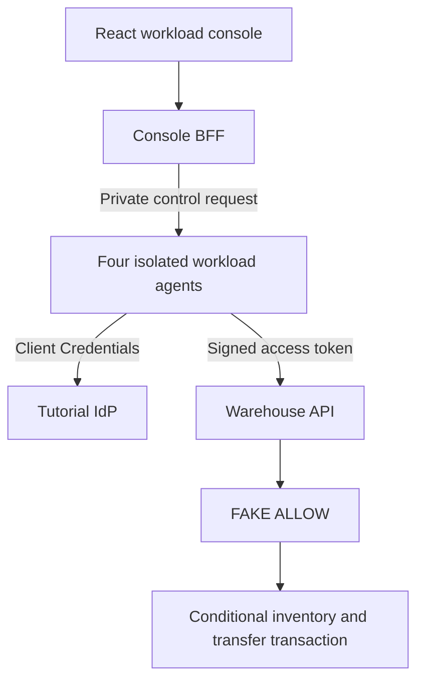

# P10 - Authorizing Warehouse Workloads with Cedarling

P10 moves stock between two warehouses. Its console sends commands through
four workload agents, each authenticated with OAuth Client Credentials.

The learning baseline validates workload tokens and requests, while business
permissions return `FAKE ALLOW`. Cedarling will restrict each workload to its
warehouse and operation.

## Architecture



## Prerequisites

- Docker Desktop or Docker Engine with Compose.
- Node.js 24.21 or newer within 24.x.
- pnpm 10.17.1.

## Run

From this project directory, start with Docker:

```bash
docker compose up --build
```

Open <http://localhost:17010>. The tutorial IdP is <http://localhost:18010>.
Stop with `Ctrl+C`, then `docker compose down`.

For native development:

```bash
pnpm --dir ../shared/identity-provider install --frozen-lockfile
pnpm install --frozen-lockfile
pnpm dev
```

`pnpm dev` prepares configuration and starts the IdP, Warehouse API, four
agents, and console. Refresh after a browser-source rebuild.
The console uses workload identities and opens directly.

## Exercise

The workloads have these intended responsibilities:

- Transfer Planner creates transfers.
- North Warehouse releases North stock and receives North deliveries.
- South Warehouse releases South stock and receives South deliveries.
- Inventory Auditor reads inventory.

Choose **New transfer**, select North to South, choose an item and quantity,
then create it as Planner. Release it as North, then receive it as South.
Planning leaves stock unchanged; release deducts from the source and receipt
adds to the destination.

Repeat with a new transfer. Use **Try another workload** at each step:

1. Create as Auditor despite its read-only responsibility.
2. Release North's stock as South.
3. Receive the South-bound delivery as North.

All three operations succeed in the baseline. Stock, transfer-state, and version
checks still apply.

## Data and reset

Restarts preserve your changes. For native data, stop the app, run
`pnpm reset`, then `pnpm dev`. Reset restores stock and removes transfers and
retry records.

For the default Docker setup:

```bash
docker compose down
docker volume rm p10-warehouse-workloads_p10-data
docker compose up --build
```

This removes application data and preserves IdP credentials. Custom Compose
project names or data mounts require their corresponding data target.

## Commands

| Command | Purpose |
| --- | --- |
| `pnpm run setup` | Prepare workload credentials and inventory |
| `pnpm start` | Build and run the complete native stack |
| `pnpm test:e2e` | Exercise the workload console in Chromium |

## Verify

Stop this project's running stack before checking local changes. `pnpm check`
runs formatting, lint, type checks, tests, build, and browser checks using
disposable data. Install Chromium once:

```bash
pnpm exec playwright install chromium
pnpm check
```

On Linux, add `--with-deps` to the Chromium installation command if system
libraries are missing.
