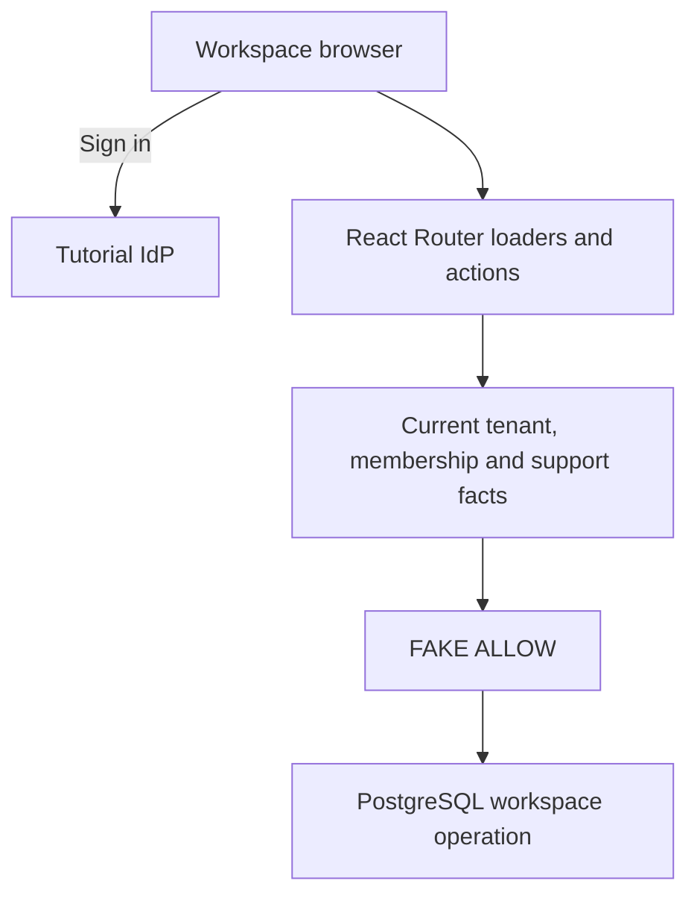

# P11 - Securing Active-Tenant Switching in a SaaS Workspace with Cedarling

P11 is a SaaS workspace for two organizations. Members switch workspaces,
edit projects, invite colleagues, and open temporary support access.

This learning baseline authenticates users and validates requests. Business
permissions return `FAKE ALLOW`; Cedarling will enforce current tenant roles,
membership, and support scope.

## Architecture



## Prerequisites

- Docker Desktop or Docker Engine with Compose.
- Node.js 24.21 or newer within 24.x.
- pnpm 10.17.1.

Native startup uses Docker for PostgreSQL on port 5435.

## Run

From this project directory, start with Docker:

```bash
docker compose up --build
```

Open <http://localhost:17011>. The tutorial IdP is <http://localhost:18011>.
Stop with `Ctrl+C`, then `docker compose down`.

For native development:

```bash
pnpm --dir ../shared/identity-provider install --frozen-lockfile
pnpm install --frozen-lockfile
pnpm dev
```

`pnpm dev` prepares configuration and starts the database, IdP, and application.

## Exercise

Choose an account. Use the prefilled username, or enter its lowercase first
name, and any non-empty password such as `cedarling-is-awesome`.

- Maya administers Aster (Tenant A) and is a viewer in Boreal (Tenant B).
- Noah edits Aster projects; his intended role excludes billing.
- Lena has a pending Aster invitation.
- Imani has support approval to read `project-a1`.

Try editing an Aster project as Noah. As Lena, open **My invitations**, accept
with `p11-lena-invite-token`, then choose **Open Tenant A · Aster**.
As Imani, open **Support access**, start a session, and read the approved project.
Use separate browser profiles when comparing accounts.

Then reproduce the permission gaps:

1. As Maya, switch to Boreal and save an edit despite her viewer role.
2. Return to an Aster project. In another native terminal, run
   `pnpm admin revoke user-maya aster`, then reload Maya's project: it still
   opens. Restore membership with `pnpm admin restore user-maya aster`.
3. With Imani's support session open, visit
   <http://localhost:17011/organizations/aster/projects/project-a2> and edit it.
   Her approval covers only reads of `project-a1`.

For Docker membership changes, use these commands instead:

```bash
docker compose exec cedarworkspace node --env-file=/run/config/app.env scripts/admin.ts revoke user-maya aster
docker compose exec cedarworkspace node --env-file=/run/config/app.env scripts/admin.ts restore user-maya aster
```

Reload the project between revocation and restoration.

Lena's invitation expires after fifteen minutes. To repeat, create an Aster
invitation as Maya in **Members** and give its token to Lena.

Imani's approval lasts two hours; each support session lasts ten minutes.
Renew the approval with `pnpm admin renew-support support-imani-a1`, then open
a new session. For Docker:

```bash
docker compose exec cedarworkspace node --env-file=/run/config/app.env scripts/admin.ts renew-support support-imani-a1
```

## Data and reset

Restarts preserve workspace changes. Stop the native app, run `pnpm reset`,
then `pnpm dev` and sign in again. For a running Docker stack:

```bash
docker compose exec cedarworkspace node --env-file=/run/config/app.env scripts/reset.ts
```

Reset restores fixtures and clears workspace records and sessions in the
configured `P11_DATABASE_URL`. Use a disposable tutorial database.
Configuration and IdP credentials are preserved.

## Commands

| Command | Purpose |
| --- | --- |
| `pnpm run setup` | Prepare configuration and initialize PostgreSQL |
| `pnpm start` | Run the built app; requires PostgreSQL and the IdP |

## Verify

`pnpm check` runs formatting, lint, type checks, unit tests, and build.
The integration scenario needs Docker and free application, IdP, and database
ports; stop your P11 app and Compose stack first. It uses disposable data.
Install Chromium once:

```bash
pnpm exec playwright install chromium
pnpm check
pnpm test:e2e
```

On Linux, add `--with-deps` to the Chromium installation command if needed.
