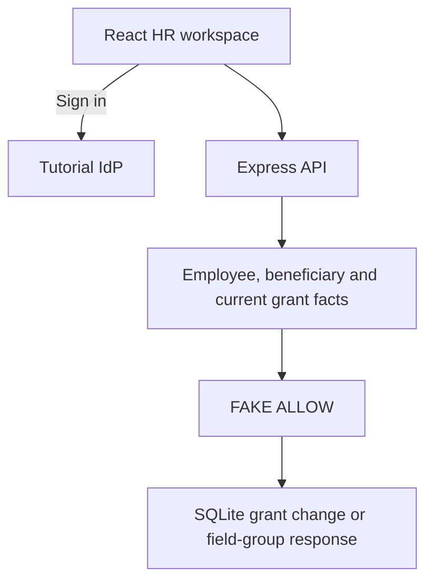

# P12 - Governing Employee Record Access with Cedarling

P12 is an HR workspace with an employee directory and temporary access to
contact or medical records. HR staff request access for a colleague; a reviewer
approves or declines it. Approved access can expire or be revoked.

Business permissions return `FAKE ALLOW` in this learning baseline. Cedarling
will check independent review, manager or clinician authority, and current
grants for the requested employee. Authentication, tenant containment,
validation, and workflow checks remain active.

## Architecture



## Prerequisites

- Docker Desktop or Docker Engine with Compose.
- Node.js 24.21 or newer within 24.x.
- pnpm 10.17.1.

## Run

From this project directory, start with Docker:

```bash
docker compose up --build
```

Open <http://localhost:17012>. The tutorial IdP is <http://localhost:18012>.
Stop with `Ctrl+C`, then `docker compose down`.

For native development:

```bash
pnpm --dir ../shared/identity-provider install --frozen-lockfile
pnpm install --frozen-lockfile
pnpm dev
```

`pnpm dev` prepares configuration and starts the IdP and application.
After a browser-source rebuild, refresh the page.

## Exercise

Choose an account. Use the prefilled username, or enter its lowercase first
name, and any non-empty password such as `cedarling-is-awesome`. Dr. Aya's
username is `aya`.

- Lin requests access as an HR administrator and also has reviewer duty.
- Nia is an independent reviewer.
- Ben manages Cora, Amina, and Jonas.
- Dr. Aya is the occupational-health clinician.

1. Open **Employees**, find Cora Mensah, and inspect **Profile**, **Contact**,
   and **Medical**.
2. As Lin, request Cora's contact details for Ben. Give a reason and choose
   one to seven days. As Nia, open **Access requests** and approve it.
3. Read Cora's contact details as Ben, revoke the grant as Nia, and read again.
   The baseline still returns the fields after revocation.
4. As Lin, create another request and approve it yourself. The baseline permits
   self-approval despite the intended independent-review rule.
5. Request medical access for Dr. Aya. Contact and medical grants are separate;
   changing one leaves the other intact.

All accounts can open the task pages and attempt these actions. Access periods
start at approval; unanswered requests expire after 24 hours. Declining requires
a reason. Declined, revoked, or expired requests remain visible; submit a fresh
request to try again.

## Data and reset

Employee and medical records are fictional and read-only.

Restarts preserve your changes. To reset native data, stop the app, run
`pnpm reset`, then `pnpm dev`.
For Docker, keep the IdP running and reset the stopped application:

```bash
docker compose stop cedarhr
docker compose run --rm --no-deps cedarhr node --env-file=/run/config/app.env dist/server/data/reset.js
docker compose up --build
```

Reset restores employee fixtures and clears access requests, grants, and
sessions. IdP credentials are preserved.

## Commands

| Command | Purpose |
| --- | --- |
| `pnpm run setup` | Prepare configuration and SQLite |
| `pnpm start` | Run the built app; requires a running IdP |

## Verify

`pnpm check` runs formatting, lint, type checks, tests, and build.
The native and Docker scenarios use disposable data and separate ports:

```bash
pnpm check
pnpm test:e2e
pnpm test:docker
```

The last command requires Docker.
