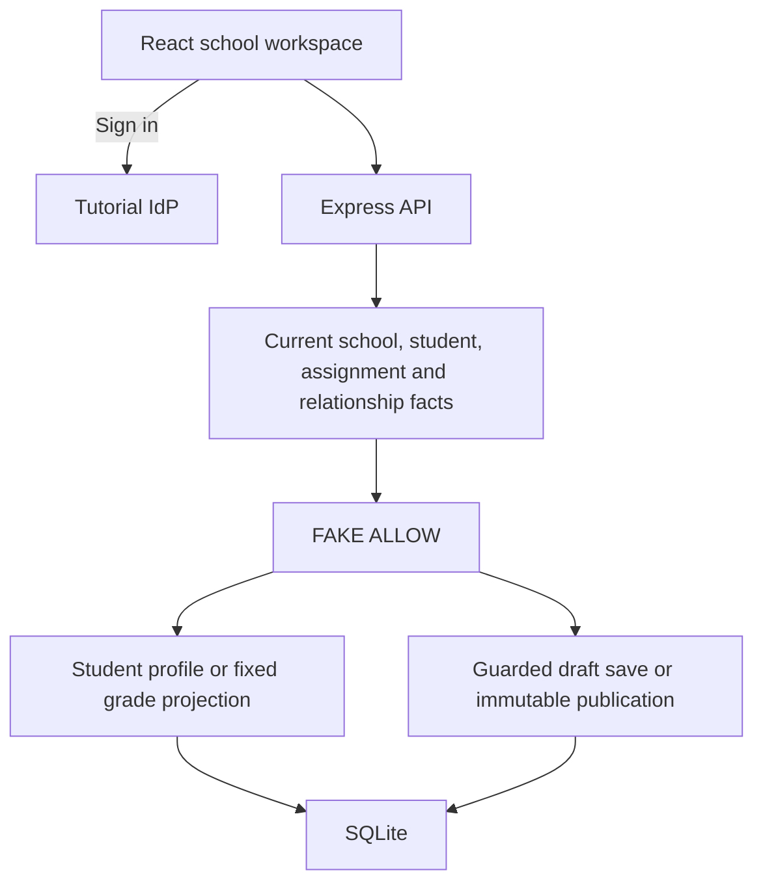

# P13 - Protecting Grade Publication and Guardian Access with Cedarling

P13 is a school workspace for student records and assessment results. Teachers
save grade drafts and publish completed assessments. Students and guardians
have separate result views; published grades are read-only.

Permissions return `FAKE ALLOW` in this learning baseline. Cedarling will check
teaching assignments, enrollments, and guardian links. Authentication, school
containment, validation, and version checks remain active.

## Architecture



## Prerequisites

- Docker Desktop or Docker Engine with Compose.
- Node.js 24.21 or newer within 24.x.
- pnpm 10.17.1.

## Run

From this project directory, start with Docker:

```bash
docker compose up --build
```

Open <http://localhost:17013>. The tutorial IdP is <http://localhost:18013>.
Stop with `Ctrl+C`, then `docker compose down`.

For native development:

```bash
pnpm --dir ../shared/identity-provider install --frozen-lockfile
pnpm install --frozen-lockfile
pnpm dev
```

`pnpm dev` prepares configuration and starts the IdP and application.
After a browser-source rebuild, refresh the page.

## Exercise

Choose an account. Use the prefilled username, or enter its lowercase first
name, and any non-empty password such as `cedarling-is-awesome`. René's
username is `rene`.

- Talia teaches Algebra; René teaches Biology.
- Sam and Ava are students.
- Grace is linked to Sam and Maya; Imani is linked to Ava.

1. As Talia, find Sam in **Students** and choose **Open gradebook**. Save
   feedback on Algebra Quiz 1, then publish it. Its grade and private teacher
   note become read-only. Keep Quiz 2 as a draft.
2. Open Quiz 1 as Sam in **Student results**, then as Grace in **Guardian
   results**. Sam sees a numeric score and feedback; Grace sees a letter
   grade. Both responses exclude the private teacher note.
3. As Talia, edit and publish Ava's Biology Lab 1 despite having no Biology
   assignment. As Sam or Grace, open the gradebook and use its draft controls.

In another native terminal, withdraw Sam's enrollment:

```bash
pnpm fixture withdraw-enrollment
```

As Talia, reopen Sam's Algebra Quiz 2, save a score and feedback, then publish.
These actions still succeed after withdrawal. Restore
enrollment with `pnpm fixture restore-enrollment`.

Run `pnpm fixture revoke-guardian` and reopen Sam's published Quiz 1 as Grace:
access still succeeds. Restore the link with `pnpm fixture restore-guardian`.
Guardian links expire after 24 hours; restoration renews Grace's link to Sam.
Grace should need a current link, while Sam should retain his own published
results after withdrawal.

For Docker fixture changes, replace `pnpm fixture` with
`docker compose exec cedarschool node --env-file=/run/config/app.env dist/server/data/fixture-cli.js`,
followed by the same command name.

## Data and reset

All student records are fictional.

Restarts preserve your changes. To reset native data, stop the app, run
`pnpm reset`, then `pnpm dev`.
For Docker, keep the IdP running and reset the stopped application:

```bash
docker compose stop cedarschool
docker compose run --rm --no-deps cedarschool node --env-file=/run/config/app.env dist/server/data/reset.js
docker compose up --build
```

Reset restores records and relationships and clears saved grades, publication
history, and application sessions. IdP credentials are preserved.

## Commands

| Command | Purpose |
| --- | --- |
| `pnpm run setup` | Prepare configuration and SQLite |
| `pnpm start` | Run the built app; requires a running IdP |

## Verify

`pnpm check` runs formatting, lint, type checks, tests, and build.
The native and Docker scenarios use disposable data and separate ports:

```bash
pnpm check
pnpm test:e2e
pnpm test:docker
```

The last command requires Docker. Build the shared IdP first if you have not
run `pnpm dev`:
`pnpm --dir ../shared/identity-provider build`.
