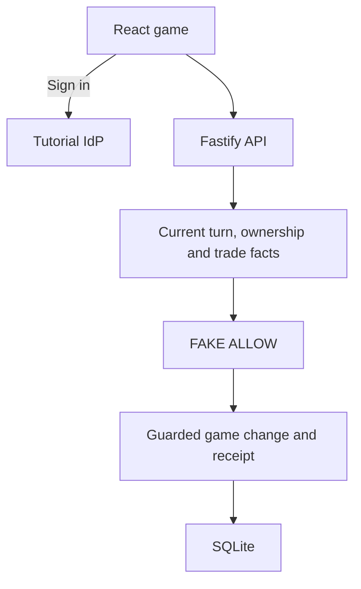

# P14 - Authorizing Turns and Property Trades with Cedarling

Capital District is a property-trading game for two to four people. Players
buy property, collect rent, improve color groups, and trade. After ten rounds,
the highest net worth wins; tied players share the win.

Business permissions return `FAKE ALLOW` in this learning baseline. Cedarling
will enforce turn authority, property and group ownership, and trade recipients
and expiry. Authentication, game phases, funds, and atomic transfers remain active.

## Architecture



## Prerequisites

- Docker Desktop or Docker Engine with Compose.
- Node.js 24.21 or newer within 24.x.
- pnpm 10.17.1.

## Run

From this project directory, start with Docker:

```bash
docker compose up --build
```

Open <http://localhost:17014>. The tutorial IdP is <http://localhost:18014>.
Stop with `Ctrl+C`, then `docker compose down`.

For native development:

```bash
pnpm --dir ../shared/identity-provider install --frozen-lockfile
pnpm install --frozen-lockfile
pnpm dev
```

`pnpm dev` prepares configuration and starts the IdP and application. Vite
refreshes browser changes; server changes restart the app.

## Exercise

Choose an account. Use the prefilled username, or enter its lowercase first
name, and any non-empty password such as `cedarling-is-awesome`.

1. Sign in as Dina in one window and Amara in a private window, separate
   browser profile, or another browser. Ordinary tabs share an account.
2. Create a game as Dina and share its link with Amara. Join as Amara, then
   choose **Start game** as Dina. Benoit and Chloe can join before the start.
3. Roll, buy or pass, and end the turn. Select a property to see its deed and
   building costs. Use **New offer** to trade property or cash.

Players start with 1,000 credits. Passing Start grants 200. Rent can create
debt; optional spending requires funds. Buildings must be added evenly within
a group, up to three levels. Net worth combines cash, property prices, and
building costs. Debt reduces the score but keeps the player in the game.
A disconnected player keeps their seat and turn; the host can abandon the game.

For permission exercises, create a fresh two-player **Practice position** for
each attempt. Join Dina first and Amara second. Dina owns Harbor and starts in
Manage; Amara owns Market. Both start with 1,000 credits and no buildings.

- Improve Dina's West Quay as Dina for the valid ownership example. Then try
  improving Amara's Orchard Row in a fresh game: Dina can pay for that too.
- As Amara, end Dina's turn. The turn advances despite the wrong actor.
- Offer Copper Dock for Merchant Lane as Dina. Accept as Amara after two
  minutes: the expired offer still transfers the assets.
- Make that trade before expiry, then improve West Quay. It succeeds even
  after Dina loses complete ownership of Harbor.
- Accept an older offer after its property changes hands through another
  trade. The baseline still transfers the assets.

## Data and reset

Credits and properties are fictional; this game is for learning only.

Restarts preserve matches. Native and Docker runs use separate data.
To reset native data, stop the app, run `pnpm reset`, then `pnpm dev`.
For Docker, keep the IdP running and reset the stopped application:

```bash
docker compose stop capital-district
docker compose run --rm --no-deps capital-district node --env-file=/run/config/app.env dist/server/data/reset.js
docker compose up -d
```

Reset deletes matches and application sessions. IdP credentials are preserved.

## Commands

| Command | Purpose |
| --- | --- |
| `pnpm run setup` | Prepare configuration and SQLite |
| `pnpm start` | Run the built app; requires a running IdP |
| `pnpm test:e2e` | Exercise multiplayer browser scenarios |

## Verify

Stop this project's running stack before checking local changes. `pnpm check`
runs formatting, lint, type checks, tests, build, and browser checks using
disposable data. Install Chromium once:

```bash
pnpm exec playwright install chromium
pnpm check
```

On Linux, add `--with-deps` to the Chromium installation command if system
libraries are missing.

For the Docker scenario, also run `pnpm test:docker`.
