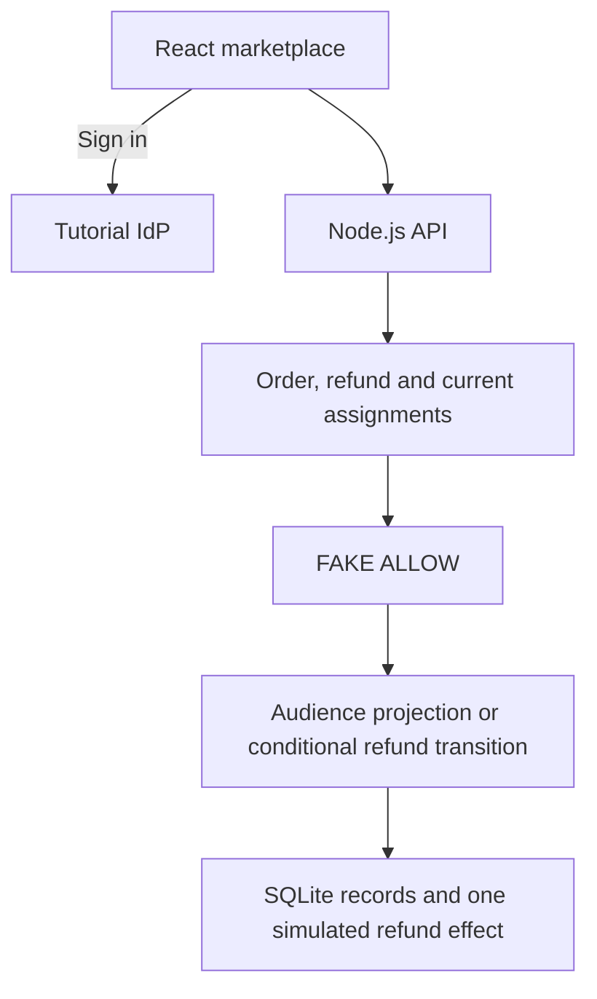

# P15 - Authorizing a Multi-Party Marketplace Refund with Cedarling

P15 follows a book purchase and refund through buyer, seller, support, and
fraud-review views. The buyer requests a refund, support approves it, and a
fraud reviewer clears or blocks it. Payments are simulated.

Business permissions return `FAKE ALLOW` in this learning baseline. Every
account can open all four views and attempt the next valid action. Cedarling
will enforce ownership, seller scope, assignments, and approval limits.

## Architecture



## Prerequisites

- Docker Desktop or Docker Engine with Compose.
- Node.js 24.21 or newer within 24.x.
- pnpm 10.17.1.

## Run

From this project directory, start with Docker:

```bash
docker compose up --build
```

Open <http://localhost:17015>. The tutorial IdP is <http://localhost:18015>.
Stop with `Ctrl+C`, then `docker compose down`.

For native development:

```bash
pnpm --dir ../shared/identity-provider install --frozen-lockfile
pnpm install --frozen-lockfile
pnpm dev
```

`pnpm dev` prepares configuration and starts the IdP and application.
After a browser-source rebuild, refresh the page.

## Exercise

Choose an account. Use the prefilled username, or enter its lowercase first
name, and any non-empty password such as `cedarling-is-awesome`.

- Bao buys books and requests refunds.
- Sela handles refunds for Sela Books.
- Diego approves assigned support cases within his limit.
- Nia reviews approved cases for fraud.

Buy a book as Bao and request a refund. Open its **Seller** view as Sela,
approve it in **Support** as Diego, then clear it as Nia. Reload the case to
confirm the completed refund keeps the same effect ID. Repeat with another
purchase, but block the approved refund as Nia; it produces no refund effect.

Use these seeded cases to exercise missing permissions. Open each link in the
browser where the named account is signed in:

1. As Bao, open [Sela's order](http://localhost:17015/?view=orders&order=order-sela-001),
   choose **View refund**, and request its refund despite another buyer owning it.
2. As Sela, open [Partner Books' refund](http://localhost:17015/?view=refunds&refund=refund-scope-gap-001&section=seller).
   The Seller view still opens for another store.
3. As Bao, request [his seeded refund](http://localhost:17015/?view=refunds&refund=refund-bao-001&section=buyer),
   switch to **Support**, and approve it despite having no support role.
4. As Diego, approve [an unassigned case](http://localhost:17015/?view=refunds&refund=refund-scope-gap-001&section=support)
   or [a case above his limit](http://localhost:17015/?view=refunds&refund=refund-limit-gap-001&section=support).
5. As Bao, review [an approved case](http://localhost:17015/?view=refunds&refund=refund-approved-001&section=fraud)
   despite having no fraud assignment.

Completed and blocked refunds remain available to inspect.

## Data and reset

Restarts preserve your changes. For native data, stop the app, run
`pnpm reset`, then `pnpm dev`. Reset removes exercise purchases and refund
changes, restores fixtures, and clears sessions.

For the default Docker setup:

```bash
docker compose down
docker volume rm p15-marketplace_p15-data
docker compose up --build
```

This removes application data and preserves IdP credentials. Custom Compose
project names or data mounts require their corresponding data target.

## Commands

| Command | Purpose |
| --- | --- |
| `pnpm run setup` | Prepare configuration and marketplace fixtures |
| `pnpm start` | Run the built app; requires a running IdP |
| `pnpm test:browser` | Exercise the marketplace in Chromium |

## Verify

Stop this project's running stack before checking local changes. `pnpm check`
runs formatting, lint, type checks, unit tests, build, and browser checks using
disposable data. Install Chromium once:

```bash
pnpm exec playwright install chromium
pnpm check
```

On Linux, add `--with-deps` to the Chromium installation command if system
libraries are missing.

Also run `pnpm test:e2e` for the HTTP/OIDC and restart-persistence scenarios.
Build the shared IdP first if you have not run `pnpm dev`:
`pnpm --dir ../shared/identity-provider build`.
