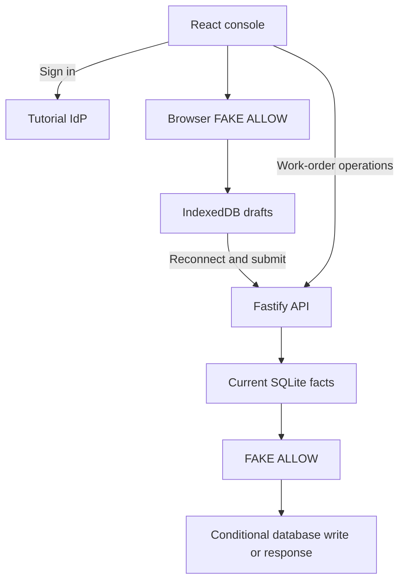

# P6 - Reauthorizing Offline Field Inspections with Cedarling

P6 lets technicians inspect equipment, save answers offline, and submit them
when they reconnect. A supervisor reviews the inspection, requests corrections,
or completes the work order.

This learning baseline authenticates users and validates requests. Business
permissions return `FAKE ALLOW`; Cedarling will enforce assignments and
supervisor authority.

## Architecture



## Prerequisites

- Docker Desktop or Docker Engine with Compose.
- Node.js 24.21 or newer within 24.x.
- pnpm 10.17.1.

## Run

From this project directory, start with Docker:

```bash
docker compose up --build
```

Open <http://localhost:17006>. The tutorial IdP is <http://localhost:18006>.
Stop with `Ctrl+C`, then `docker compose down`.

For native development:

```bash
pnpm --dir ../shared/identity-provider install --frozen-lockfile
pnpm install --frozen-lockfile
pnpm dev
```

`pnpm dev` prepares configuration and starts the IdP and application.
After a browser-source rebuild, refresh the page.

## Exercise

Choose an account. Use the prefilled username, or enter its lowercase first
name, and any non-empty password such as `cedarling-is-awesome`.

- Elena inspects Cooling pump 17 at North Plant.
- Malik is a technician who can take over Elena's work order.
- Rowan supervises assignments and inspection reviews.

Use separate browser profiles or a private window for Elena and Rowan;
ordinary tabs share a session. Keep Elena's page open while offline.

1. As Elena, open **Cooling pump 17** and set that browser's network to
   **Offline** in developer tools. Answer the three checks, add notes for any
   failure, then choose **Queue inspection**.
2. Sign in as Rowan in the online browser. Use **Manage order** to reassign
   the pump to Malik.
3. Restore Elena's connection. Her queued inspection is sent automatically;
   choose **Retry sending** if needed. It reaches **Awaiting review** even
   though Elena is no longer assigned.
4. As Rowan, refresh the order and review it. Failed checks require
   **Request corrections** and review notes. **Complete work order** requires
   all checks to pass.

**Refresh work order** loads current assignments and history and renews the
five-minute offline queue window for an open order or one needing corrections.
After expiry, local saving remains available; reconnect and refresh before
queuing new work. Refresh and review the record after a version conflict.

As Elena, also try opening Malik's order, using **Add work order**, reassigning
an order, reviewing a submission, or deleting an uninspected order. These actions
succeed despite her technician role; lifecycle and version checks still apply.

## Data and reset

Restarts preserve your changes. For native data, stop the app, run
`pnpm reset`, then `pnpm dev`. Reset restores work orders and clears inspection
history and sessions.

For the default Docker setup:

```bash
docker compose down
docker volume rm p6-field-inspection_p6-data
docker compose up --build
```

This removes application data and preserves IdP credentials. Custom Compose
project names or data mounts require their corresponding data target.

Browser drafts remain on the device. Remove them separately with
**Discard saved draft** or **Saved drafts on this device**.

## Commands

| Command | Purpose |
| --- | --- |
| `pnpm run setup` | Prepare configuration and inspection fixtures |
| `pnpm start` | Run the built app; requires a running IdP |
| `pnpm test:e2e` | Exercise the browser inspection workflow |

## Verify

Stop this project's running stack before checking local changes. `pnpm check`
runs formatting, lint, type checks, tests, build, and browser checks using
disposable data. Install Chromium once:

```bash
pnpm exec playwright install chromium
pnpm check
```

On Linux, add `--with-deps` to the Chromium installation command if system
libraries are missing.
