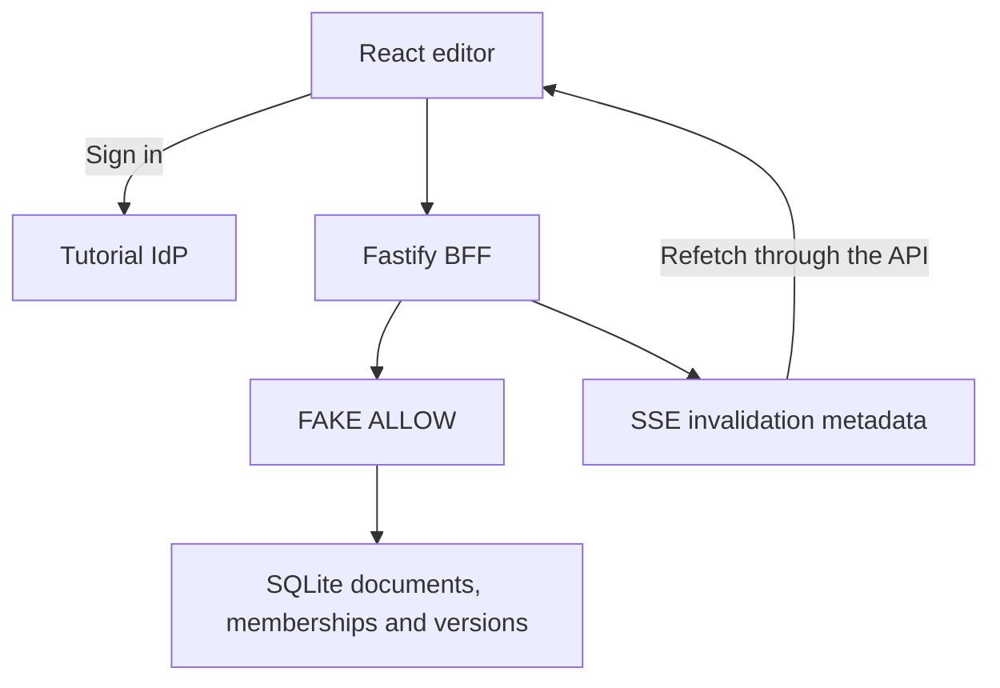

# P7 - Securing Real-Time Collaborative Documents with Cedarling

P7 lets collaborators edit plain-text documents, comment, and manage access.
Live events prompt open browsers to reload current document data.

This learning baseline authenticates users and validates requests. Document,
comment, sharing, and live-update permissions return `FAKE ALLOW` until
Cedarling is integrated.

## Architecture



## Prerequisites

- Docker Desktop or Docker Engine with Compose.
- Node.js 24.21 or newer within 24.x.
- pnpm 10.17.1.

## Run

From this project directory, start with Docker:

```bash
docker compose up --build
```

Open <http://localhost:17007>. The tutorial IdP is <http://localhost:18007>.
Stop with `Ctrl+C`, then `docker compose down`.

For native development:

```bash
pnpm --dir ../shared/identity-provider install --frozen-lockfile
pnpm install --frozen-lockfile
pnpm dev
```

`pnpm dev` prepares configuration and starts the IdP and application.
After a browser-source rebuild, refresh the page.

## Exercise

Choose an account. Use the prefilled username, or enter its lowercase first
name, and any non-empty password such as `cedarling-is-awesome`.

- Maya Chen (`maya`) owns the launch brief and a private planning document.
- Noah Williams (`noah`) edits the launch brief.
- Lena Ortiz (`lena`) comments on the launch brief.

Create a document as Maya, edit it, and choose **Save changes**. Open
**Comments** or **Access** to discuss it or manage collaborators.

Compare these permission gaps:

1. Noah can open Maya's private planning document without membership.
2. Lena can edit the launch brief despite her comment-only role.
3. Noah can change another collaborator's role or remove their access.
4. In separate browser profiles, open the launch brief as Noah and Maya.
   Remove Noah as Maya, then save another edit. Noah still receives the update
   and can reload the document.

## Data and reset

Restarts preserve your changes. For native data, stop the app, run
`pnpm reset`, then `pnpm dev`. Reset removes document, comment, and access changes
and clears application sessions.

For the default Docker setup:

```bash
docker compose down
docker volume rm p7-collaborative-docs_p7-data
docker compose up --build
```

This removes application data and preserves IdP credentials. Custom Compose
project names or data mounts require their corresponding data target.

## Commands

| Command | Purpose |
| --- | --- |
| `pnpm run setup` | Prepare configuration and collaboration fixtures |
| `pnpm start` | Run the built app; requires a running IdP |
| `pnpm test:e2e` | Exercise browser collaboration |

## Verify

Stop this project's running stack before checking local changes. `pnpm check`
runs formatting, lint, type checks, tests, build, and browser checks using
disposable data. Install Chromium once:

```bash
pnpm exec playwright install chromium
pnpm check
```

On Linux, add `--with-deps` to the Chromium installation command if system
libraries are missing.
