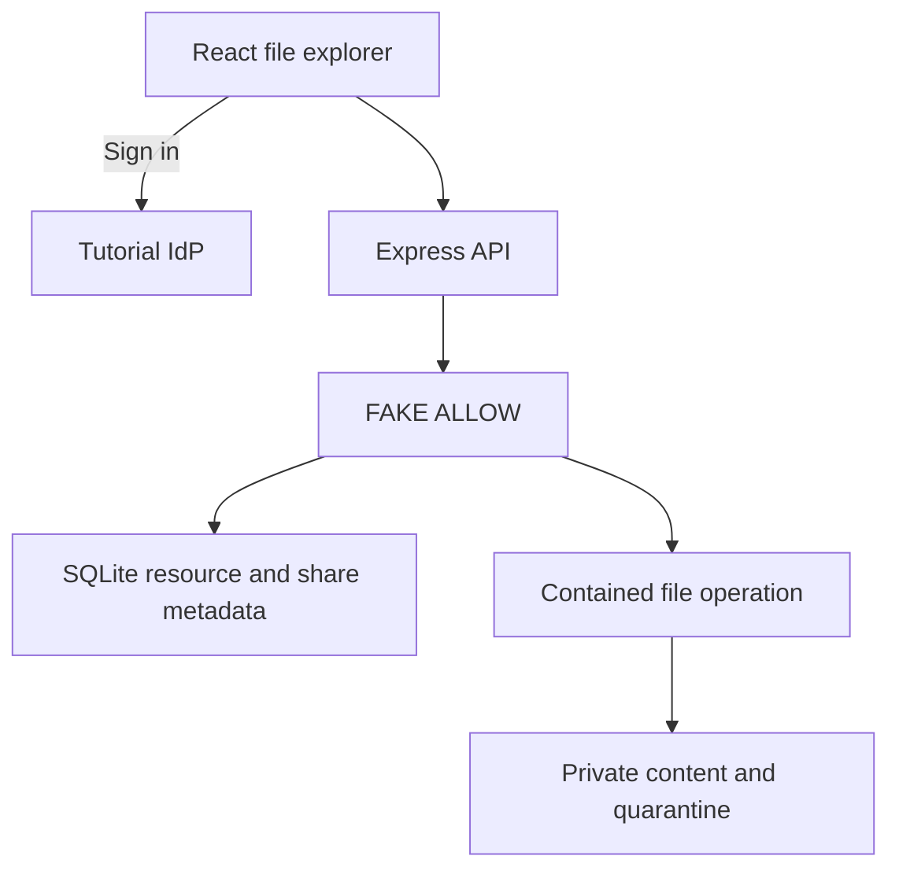

# P8 - Securing File Sharing and Blocking Path Traversal with Cedarling

P8 is a workspace for uploading, previewing, editing, and sharing files in folders.

File permissions return `FAKE ALLOW` in this learning baseline. Authentication,
request validation, and filesystem containment remain active; Cedarling will
control access to files and sharing operations.

## Architecture



## Prerequisites

- Docker Desktop or Docker Engine with Compose.
- Node.js 24.21 or newer within 24.x.
- pnpm 10.17.1.

The Linux Docker stack is the reference environment for filesystem safety.

## Run

From this project directory, start with Docker:

```bash
docker compose up --build
```

Open <http://localhost:17008>. The tutorial IdP is <http://localhost:18008>.
Stop with `Ctrl+C`, then `docker compose down`.

For native development:

```bash
pnpm --dir ../shared/identity-provider install --frozen-lockfile
pnpm install --frozen-lockfile
pnpm dev
```

`pnpm dev` prepares configuration and starts the IdP and application.
After a browser-source rebuild, refresh the page.

## Exercise

Choose an account. Use the prefilled username, or enter its lowercase first
name, and any non-empty password such as `cedarling-is-awesome`.

- Jordan owns Workspace A.
- Priya has editor access to Jordan's Launch assets folder.
- Lee belongs to Workspace B and can view shared-overview.txt.

As Jordan, create a folder, upload a supported file, preview it, and share it.
Double-click a folder or choose **Open folder**. In **Shared with me**, open the
destination folder before uploading or creating a subfolder.

Then compare the intended roles with the baseline behavior:

1. As Priya, reshare or delete launch-notes.md under Launch assets.
2. As Lee, edit shared-overview.txt despite having viewer access.
3. In Lee's signed-in browser, open
   <http://localhost:17008/api/resources/res_01K3PRIVATEA/content> to read an
   unshared file. As Jordan, open
   <http://localhost:17008/api/resources/res_01K3PRIVATEB/content> to read a
   file from Workspace B.

Upload limits, name collisions, and version checks apply to every account.

## Data and reset

Restarts preserve your changes. For native data, stop the app, run
`pnpm reset`, then `pnpm dev`. Reset deletes uploads, restores the original files
and shares, and clears application sessions.

For the default Docker setup:

```bash
docker compose down
docker volume rm p8-cedarfile_p8-data
docker compose up --build
```

This removes application data and preserves IdP credentials. Custom Compose
project names or data mounts require their corresponding data target.

## Commands

| Command | Purpose |
| --- | --- |
| `pnpm run setup` | Prepare configuration and file storage |
| `pnpm start` | Run the built app; requires a running IdP |

## Verify

`pnpm check` runs formatting, lint, type checks, tests, and build.
The integration scenario requires Docker and uses disposable data; stop your
running P8 stack first.

```bash
pnpm check
pnpm test:e2e
```
