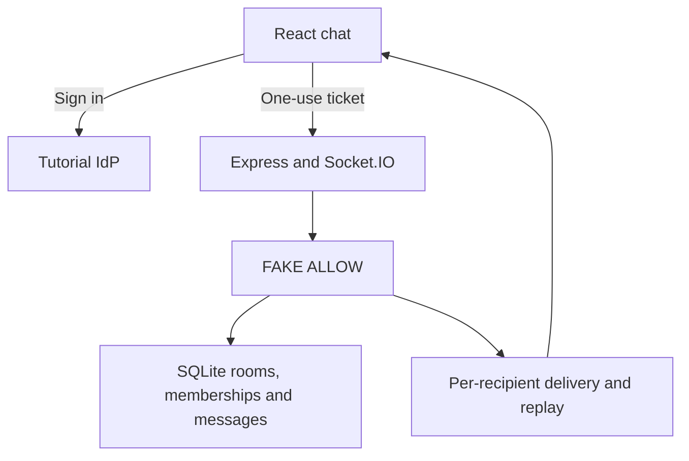

# P9 - Securing Realtime Chat Rooms and Events with Cedarling

P9 is a multi-tenant chat application with live messages, membership management,
and moderation.

This learning baseline authenticates users and validates requests. Joining,
sending, receiving, replay, and moderation permissions return `FAKE ALLOW`;
Cedarling will check current room membership and authority.

## Architecture



## Prerequisites

- Docker Desktop or Docker Engine with Compose.
- Node.js 24.21 or newer within 24.x.
- pnpm 10.17.1.

## Run

From this project directory, start with Docker:

```bash
docker compose up --build
```

Open <http://localhost:17009>. The tutorial IdP is <http://localhost:18009>.
Stop with `Ctrl+C`, then `docker compose down`.

For native development:

```bash
pnpm --dir ../shared/identity-provider install --frozen-lockfile
pnpm install --frozen-lockfile
pnpm dev
```

`pnpm dev` prepares configuration and starts the IdP and application.
After a browser-source rebuild, refresh the page.

## Exercise

Choose an account. Use the prefilled username, or enter its lowercase first
name, and any non-empty password such as `cedarling-is-awesome`.

- Mei belongs to Tenant A's general room.
- Kwame moderates Tenant A's general and restricted rooms.
- Yuki is a member whom Kwame can remove.

Use separate browser profiles. Send a message as Mei and check that Kwame and
Yuki receive it. Enter sends; Shift+Enter adds a line. A failed send keeps your
draft for retry.

Try these permission gaps:

1. As Mei, enter `room-a-restricted` or `room-b-general` using its ID.
2. Remove Yuki as Kwame, then send another message. Yuki still receives it
   and can re-enter after reconnecting.
3. As Mei, remove another member or delete someone else's message.

For reconnect replay, disconnect Mei, delete a message as Kwame, then reconnect
Mei. The latest 100 messages reload, reflecting the deletion. Message limits
and version checks still apply.

## Data and reset

Restarts preserve your changes. For native data, stop the app, run
`pnpm reset`, then `pnpm dev`. Reset restores rooms and memberships, removes
messages, and clears application sessions.

For the default Docker setup:

```bash
docker compose down
docker volume rm p9-cedarrealtime_p9-data
docker compose up --build
```

This removes application data and preserves IdP credentials. Custom Compose
project names or data mounts require their corresponding data target.

## Commands

| Command | Purpose |
| --- | --- |
| `pnpm run setup` | Prepare configuration and chat fixtures |
| `pnpm start` | Run the built app; requires a running IdP |

## Verify

`pnpm check` runs formatting, lint, type checks, tests, and build.
The integration scenario requires Docker and uses disposable data; stop your
running P9 stack first.

```bash
pnpm check
pnpm test:e2e
```
